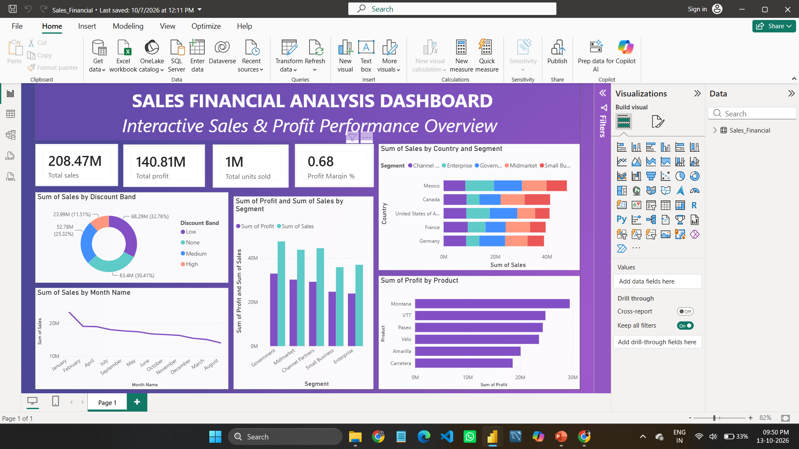

# 📊 Sales Financial Analysis Dashboard

## 📌 Project Overview

The **Sales Financial Analysis Dashboard** is a data analytics project developed using Microsoft Power BI. It analyzes sales and financial data to understand business performance, identify trends, and compare sales and profitability across products, countries, and business segments.

The dashboard presents key performance indicators (KPIs) and interactive visualizations to support data-driven decision-making.

## 🎯 Project Objectives

- Analyze overall sales and profit performance.
- Track important key performance indicators (KPIs).
- Compare sales across countries and business segments.
- Analyze product-level profitability.
- Identify monthly sales trends.
- Understand sales performance across different discount bands.
- Present business insights through interactive visualizations.

## 🛠️ Tools and Technologies

- **Microsoft Power BI** — Dashboard development and data visualization
- **Power Query** — Data cleaning and transformation
- **DAX** — Calculated measures and KPI calculations
- **CSV** — Dataset format

## 📂 Dataset Overview

This project uses a sample sales and financial dataset created for analysis and dashboard development.

The dataset contains **1,000 rows and 17 columns**.

### Key Dataset Columns

| Column | Description |
|---|---|
| Segment | Business segment |
| Country | Country where sales occurred |
| Product | Product category or product name |
| Discount Band | Discount category |
| Units Sold | Number of units sold |
| Manufacturing Price | Manufacturing cost per unit |
| Sale Price | Selling price per unit |
| Date | Transaction date |
| Gross Sales | Sales amount before discounts |
| Discounts | Discount amount |
| Sales | Sales amount after discounts |
| COGS | Cost of goods sold |
| Profit | Profit amount |
| Month Number | Numeric month |
| Month Name | Month name |
| Quarter | Financial reporting quarter |
| Year | Year of the transaction |

## 📈 Dashboard Preview

## 📊 Key Performance Indicators (KPIs)

The dashboard includes the following KPIs:

- **Total Sales** — Overall sales amount
- **Total Profit** — Overall profit generated
- **Total Units Sold** — Total quantity sold
- **Profit Margin** — Profit as a percentage of sales

## 📉 Dashboard Visualizations

The dashboard contains the following charts:

1. **Sales by Discount Band** — Compares sales across discount categories.
2. **Sales by Month Name** — Shows sales trends over time.
3. **Sales and Profit by Segment** — Compares sales and profit across business segments.
4. **Sales by Country and Segment** — Compares sales across countries and segments.
5. **Profit by Product** — Compares profitability across products.

## 🔍 Key Analysis Areas

- Evaluate sales and profitability across business segments.
- Compare sales performance across countries.
- Examine monthly sales patterns.
- Analyze the relationship between discount categories and sales.
- Compare profit values across products.
- Monitor important business performance indicators.

## 💡 Key Insights

The dashboard helps users explore:

- Which business segments contribute more to sales.
- How sales change across months.
- Which countries have higher sales.
- How sales vary across discount bands.
- Which products generate higher profit.

*Note: Specific business conclusions should be verified against the final dashboard data.*

## 📁 Project Files

| File | Description |
|---|---|
| `Sales_Financial.csv` | Sample sales and financial dataset |
| `Sales_Financial.pbix` | Power BI dashboard file |
| `Task4_Presentation.pptx` | Project presentation |
| `S_F_Ss.png` | Dashboard screenshot |
| `README.md` | Project documentation |

## 🚀 How to Use This Project

1. Download or clone this GitHub repository.
2. Open `Sales_Financial.pbix` using Power BI Desktop.
3. If prompted, connect or update the dataset source using `Sales_Financial.csv`.
4. Explore the dashboard visuals and KPIs.
5. Use the presentation file to review the project overview and analysis.

## 📚 Learning Outcomes

Through this project, I practiced:

- Preparing and transforming data using Power Query.
- Creating KPI measures using DAX.
- Designing interactive dashboards in Power BI.
- Selecting appropriate visualizations for sales analysis.
- Communicating data findings through charts and reports.

## 🏁 Conclusion

This project demonstrates the use of Microsoft Power BI to analyze sales and financial data through KPIs and interactive visualizations. It provides a foundation for exploring business performance and communicating data-driven findings.
